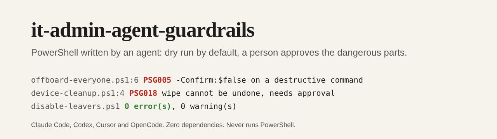

# it-admin-agent-guardrails



[](https://github.com/pJijesh/it-admin-agent-guardrails/actions/workflows/test.yml) [](LICENSE)  

**Problem:** AI agents are now asked to write PowerShell for Microsoft 365, Entra ID, Intune and Active Directory. One careless script can disable every account, wipe devices, forward a mailbox or leak a secret, and the usual code-assistant habits do not prevent that.

**For:** IT managers and administrators who let an AI agent draft administration scripts and want them read-only or dry-run by default, with a clear list of what always needs a person's approval.

**Demonstrates:** an agent skill that sets the rules for administration scripts, and a zero-dependency checker with 26 rules that finds the common mistakes in PowerShell text. Fictional safe and unsafe examples are included and are checked by the tests.

## What it does

- **Rules the agent follows**: read before write, dry run by default, named and capped targets, no secrets, least privilege, approval gates, a trail of evidence. See [`SKILL.md`](skills/it-admin-guardrails/SKILL.md).
- **A checker with 26 rules** (15 errors, 11 warnings) over `.ps1` and `.psm1` files: secrets in scripts, state changes without `-WhatIf`, `ShouldProcess` declared but never called, no dry-run default, `-Confirm:$false` on destructive commands, bulk changes over `-All`, read scripts asking for write scopes, execution policy and TLS weakening, download-and-run, hard-coded GUIDs, protections switched off, wipe and delete, Conditional Access created enabled, mail forwarding, role assignment, authentication method removal, silenced errors and deprecated modules. See [`rules.md`](skills/it-admin-guardrails/references/rules.md).
- **Overrides that need a reason**: `# guardrail-allow PSG018: approved by the service owner, ticket CHG-0000`. An override with no reason is itself an error.
- **A safe script template** with `SupportsShouldProcess`, an `-Apply` switch, a change cap, a log and error handling.
- **Installers** for Claude Code, Codex, OpenCode and Cursor.

## Install

Requires Node 18 or later. From a clone of this repository:

```bash
node scripts/install.mjs claude            # into the current project
node scripts/install.mjs codex
node scripts/install.mjs opencode
node scripts/install.mjs cursor
node scripts/install.mjs all --dry-run     # show what would be written
node scripts/install.mjs claude --global   # Claude Code, every project
```

| Agent | What is written |
| --- | --- |
| Claude Code | The skill in `.claude/skills/it-admin-guardrails/` (or `~/.claude/skills/` with `--global`) |
| Codex | The skill in `.agents/skills/it-admin-guardrails/` and a marked block in `AGENTS.md` |
| OpenCode | The skill in `.opencode/skills/it-admin-guardrails/` and a marked block in `AGENTS.md` |
| Cursor | A rule in `.cursor/rules/it-admin-guardrails.mdc` and the scripts in `.cursor/it-admin-guardrails/` |

Then ask your agent, for example: "Using the it-admin-guardrails skill, write a script that disables the leavers in this CSV."

You can also run the checker on its own, for example in a pull request check:

```bash
node skills/it-admin-guardrails/scripts/check-ps.mjs scripts/
node skills/it-admin-guardrails/scripts/check-ps.mjs offboard.ps1 --fail-on warning
node skills/it-admin-guardrails/scripts/check-ps.mjs scripts/ --json
node skills/it-admin-guardrails/scripts/check-ps.mjs --rules
```

## How it works

```text
ask -> read-only version -> change version -> check-ps.mjs -> report -> a person approves -> -Apply
                                                  |
                          26 text rules, exit 1 on errors, overrides need a reason
```

Run over the unsafe fictional examples, the checker reports what a reviewer would circle:

```text
$ node skills/it-admin-guardrails/scripts/check-ps.mjs examples/unsafe
device-cleanup.ps1:3  PSG006  error  this loop changes every object returned by -All; filter the set, ...
device-cleanup.ps1:4  PSG018  error  wipe, retire and delete cannot be undone; require a named device list ...
offboard-everyone.ps1:3  PSG001  error  a secret appears to be written into the script; ...
offboard-everyone.ps1:6  PSG005  error  -Confirm:$false removes the last safety prompt from a destructive command
...
3 file(s): 18 error(s), 10 warning(s)
```

The safe examples, [`disable-leavers.ps1`](examples/safe/disable-leavers.ps1) and [`report-stale-guests.ps1`](examples/safe/report-stale-guests.ps1), and the template pass with no findings. The full recorded output for the unsafe scripts is in [`examples/unsafe-findings.json`](examples/unsafe-findings.json).

## How it is built

```text
.
├── skills/it-admin-guardrails/
│   ├── SKILL.md              The process and ground rules
│   ├── core.md               Condensed text for AGENTS.md and Cursor
│   ├── references/           principles, PowerShell patterns, Graph scopes, approval gates, rules
│   ├── templates/            A safe script template
│   └── scripts/              check-ps.mjs (CLI), lib.mjs (checker), rules.json
├── scripts/                  install.mjs and build.mjs (generates the adapters)
├── adapters/                 Generated AGENTS.md block and Cursor rule
├── examples/                 Fictional safe and unsafe scripts, and recorded findings
├── test/                     node:test suites
└── .github/workflows/test.yml
```

## Design choices

- **Dry run is the default.** The template plans and exits unless `-Apply` is passed, so forgetting a flag is safe.
- **The set matters more than the command.** Most disasters are the right command on the wrong set, so the rules push towards named, reviewed, capped targets.
- **Some changes always need a person.** Wipes, privileged roles, forwarding, authentication methods, Conditional Access and switching protections off are errors, and an override records who approved.
- **The checker reads text and never runs PowerShell.** It is safe to point at an untrusted script, and it needs no Windows machine or Microsoft modules.
- **Honest limits.** A clean result means no known pattern was found, and the skill tells the agent to say so.
- **Zero dependencies and deterministic output**, so the checker can run in any pipeline.

## Limitations

- **It is a set of text patterns, not a PowerShell parser.** It does not follow variables across lines, resolve most aliases, or know what a custom function does. It will miss things and will sometimes flag safe code, including a command name inside a string.
- **A clean result is not a safety certificate.** Review the script, run the dry run and have the change approved.
- **Microsoft cmdlet and permission names change.** The patterns cover the Microsoft Graph PowerShell, Exchange Online, Active Directory and Defender cmdlets I know of, and the scope guidance should be checked against Microsoft's current permissions reference.
- **No tenant was used.** Nothing here has been run against a real Microsoft 365 or Active Directory environment, and the example scripts are fictional.
- **The installer paths follow each tool's documentation as I understand it.** They have not been tested inside Claude Code, Codex, OpenCode or Cursor themselves.

## Verification status

- The tests cover every one of the 26 rules with a bad and a good case, comment and string handling, multi-line statements, both forms of the bulk-change rule, the override syntax, exit codes, `--json`, argument handling, folder walking, each installer in a temporary directory, that the generated files are current, and repository hygiene. A test also fails if a rule is missing from `rules.json`, the documentation or the tests.
- The unsafe examples produce exactly the recorded findings, and the safe examples and template produce none.
- It was run on Node 22 here. The CI workflow covers Node 18, 20 and 22.
- The skill has not been tested with a real agent on real administration work, so there is no claim about how it performs in practice.

## Roadmap

Planned, not promised.

- **Next:** Try it with each of the four agents on real script requests and record the false positives and misses
- **Then:** Rules for Exchange Online transport and retention changes, and for SharePoint sharing settings
- **Later:** A parser-backed mode using the PowerShell AST, as an optional second opinion

## Related work

PSScriptAnalyzer is the established static analyser for PowerShell and covers style and general correctness; use it as well. This project is narrower: it targets the risks of administration scripts written with an AI agent. It shares no code with PSScriptAnalyzer.

## Licence

[MIT](LICENSE), 2026 Puliyappottammal Jijesh. See [CONTRIBUTING](CONTRIBUTING.md) for how to suggest a change.

Built by [Puliyappottammal Jijesh](https://www.linkedin.com/in/pjijesh), an IT manager. [GitHub](https://github.com/pJijesh)
